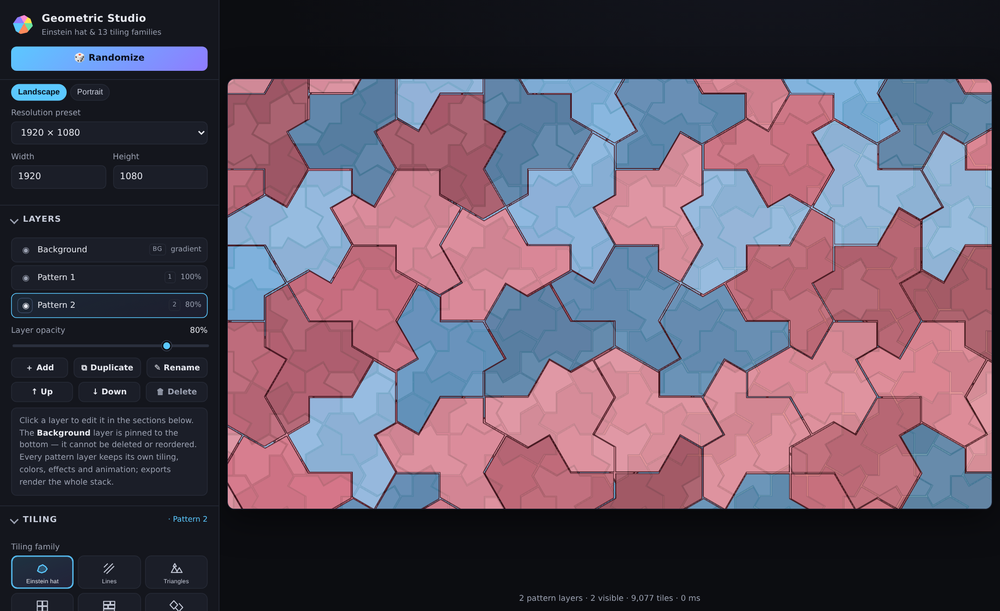

# Einstein Wallpaper — Geometric Wallpaper Studio 🎩

Generate wallpapers from the **Einstein tile** (the aperiodic "hat" monotile discovered
in 2023 by David Smith, Joseph Samuel Myers, C. S. Kaplan and Chaim Goodman-Strauss) —
**plus 13 more mathematically verified tiling families** — and compose them in a
**multi-layer compositor**: stack up to 8 pattern layers over a permanent background
layer, each with its own tiling, color theme, effects and animation. Every image can be
exported as a full-resolution **PNG**, a **looping animated GIF**, or a **lossless APNG**
(pixel-perfect animated PNG) — all encoded entirely in the browser and playable anywhere
with no extra software, plugins or codecs.



## Features

### Tiling families (14)
| Family | Variants | Notes |
|--------|----------|-------|
| **Einstein hat** | A / B / C (H, P, F roots) | True aperiodic monotile via the metatile substitution construction from *An Aperiodic Monotile* (arXiv:2303.10798). Unchanged since v1. |
| **Lines** | horizontal, vertical, diagonal 45°, crosshatch, grid | Line-based patterns (strokes, not fake tiles) |
| **Triangles** | equilateral grid, right-triangle grid | Edge-to-edge, alternating rows |
| **Squares** | aligned grid, diamond (45°), checkerboard | |
| **Rectangles** | aligned 2:1 grid, running bond, herringbone 90°, basketweave | Herringbone lattice is verified overlap-free |
| **Rhombi** | 60°/45°/30° acute angles | Affine image of the square grid |
| **Parallelograms** | slant 30° right, 45° right, 30° left | Sheared grid |
| **Hexagons** | flat-top, pointy-top honeycomb | Regular, edge-to-edge |
| **Trapezoids** | flat / standard / steep | Half-turn tessellation of a generic quadrilateral |
| **Kites** | slim / classic / wide | Half-turn tessellation |
| **Trihexagonal** | kagome, rotated 30° | Rectified honeycomb: hexagons + triangles |
| **Octagon–square** | truncated square tiling | Regular octagons + 45° squares |
| **Cairo pentagons** | dual of the snub square tiling | The classic Cairo mosaic pentagon (3 right-angle-free 120°s + two 90°s) |
| **Penrose rhombs** | P3 standard, P3 golden shifts | Dual of a de Bruijn pentagrid; matching rules hold by construction; fat:thin → φ |

Every family's geometry is verified by `tests/verify-tilings.js` (no overlaps, no
holes, correct edge lengths, Penrose fat:thin ratio → φ, Cairo pentagon shape, etc.).

### Layers — compose patterns over a background

The studio is a **layer compositor**. The **Layers panel** manages the stack:

- A dedicated **Background layer** always sits at the bottom of the stack — it
  cannot be deleted, duplicated or reordered, and it holds the wallpaper fill:
  solid color, any gradient, or a **palette-derived color via an explicit palette
  reference** (recoloring a pattern layer never silently moves the background).
- Up to **8 Pattern layers**, each with a full, independent configuration:
  tiling family + variant, tile scale, rotation, gap, outline, color theme mode
  (Single / Palette / Gradient / Duotone with arrangements, templates and
  editors), visual effects, animation (effect, speed, direction) and seed.
- Add, **duplicate** (copies every setting, assigns a fresh ID), rename,
  delete and **reorder** pattern layers; toggle each layer's visibility and
  adjust its **opacity 0–100%**.
- Selecting a layer points the existing Tiling / Color theme / Visual effects /
  Animation sections at it — there is one set of controls, not one per layer.
  Switching selection never mixes configurations between layers.

**Compositing:** every visible layer renders into its own surface, gets its own
post-processing (blur/glow/shadow/grain/vignette), then is stacked in order with
its opacity onto the shared output — tile fills, outlines, shadows and glow fade
together. The preview and all three export formats render the identical
composition. **PNG and APNG keep true RGBA transparency** whenever the
Background layer is hidden or faded below 100%; **GIF has no partial alpha**, so
transparent projects are flattened onto black.

**Independent animations:** each pattern layer runs its own animation on a
shared timeline (one layer can use Gradient Flow while another stays static).
Animated exports align every layer onto **one seamless loop**: the slowest
animation defines the loop, faster layers complete an integer number of cycles
(visual speed unchanged), and impractically long combinations are uniformly
time-compressed (the status bar notes it).

### Color — one unified Color theme section

A single **Color theme** panel with four modes. Each mode owns its dedicated
settings — arrangement, template library and an inline editor — and only the
active mode's panel is shown. Every control applies to the wallpaper in
real time, and every mode ships with templates you can customize further and
save/load as your own:

| Mode | Dedicated settings |
|------|--------------------|
| **Single** | tile color picker + a template row of curated solid colors (save/delete your own) |
| **Palette** | arrangement (how colors spread across tiles), the 26 built-in palettes as templates, inline color editor (add/remove/reorder, hex input), per-palette background + outline, save/duplicate/delete custom palettes |
| **Gradient** | arrangement (continuous **Sweep**, quantized **Bands** with band count, or **Random mix**), gradient templates, inline editor (linear/radial/conic, angle, multi-stop color/position), save/delete custom gradients |
| **Duotone** | arrangement (checkerboard / sweep / random), colors A + B, curated pair templates (save/delete your own) |

Shared across modes: outline auto/manual color and JSON theme export/import
(palettes + gradients + single/duotone templates). The wallpaper background
and the foreground opacity live on the **Layers** panel now (Background layer
fill + per-layer opacity) — see *Layers* above.

The **arrangement** is family-aware: the hat offers Supertiles (patches), By
orientation, Mirror split, Checkerboard and Random mix; periodic families
offer By tile kind / By orientation (hidden on families where every tile has
the same kind or orientation — those would render one flat color),
Checkerboard and Random mix. Sweep and Bands are normalized against the
actual tile positions, so they stay full-range gradients at every rotation
angle.

- **26 curated built-in palettes** — from Midnight and Nord to Cyberpunk and
  Sakura, light and dark.
- **Template-driven editing** — pick a template, tweak anything (colors,
  stops, angle, background, outline) with live feedback, then keep it as a
  custom template; custom palettes/gradients/single colors/duotone pairs all
  persist in the browser.
- Every color change re-colors the live preview instantly (no scene rebuild).

### Visual effects
Blur, Glow (intensity + radius), Shadow/depth (strength + softness + offset),
film Grain, and Vignette (darken or lighten edges). All default to neutral/off,
all are applied identically to the live preview and to every export format, and
all work with every tiling family.

### Animation (per layer)
- **None** (static — no frames rendered),
- **Shimmer** (soft light wave over the tiles),
- **Gradient Flow** (a repeating band of palette/gradient colors drifts across the
  pattern; direction + speed configurable, seamlessly looping),
- **Glow Wave** (a restrained band of brightness sweeps the canvas; seamless loop).

The removed v1 animations (Cascade, Drift, Hue cycle, Pulse) are gone.

### Canvas & export
- Aspect presets 16:9, 16:10, 4:3, 5:4, 3:2, 21:9, 32:9, 1:1 and phone portraits
  (9:16, 9:19.5, 9:20) with standard resolutions from 720p to 4K+, plus custom
  sizes up to 8192 px. Canvas size/aspect/resolution are the only global
  settings — every layer renders into the same output coordinate space.
- Per layer: tile scale, rotation, tile gap, outline width/color, seeded
  randomization.
- **All exports render the complete layer stack at the exact canvas resolution
  you chose** — animated exports rebuild every layer at that resolution (1:1,
  same geometry math as the preview) and capture exactly one seamless combined
  animation loop (see *Layers* above for the multi-animation alignment).
- **PNG** — full-resolution still of the composition, lossless, RGBA alpha
  preserved when the Background layer is hidden/faded.
- **GIF (looping)** — encoded entirely in the browser from the GIF89a spec:
  one global 256-color palette (median-cut across sample frames, so no palette
  flicker) with Floyd–Steinberg error-diffusion dithering, hand-written LZW,
  NETSCAPE2.0 infinite-loop extension. Plays on literally anything. GIF cannot
  carry partial alpha — transparent projects are flattened onto black.
- **APNG (lossless)** — animated PNG written from the PNG/APNG spec: truecolor
  RGBA with adaptive per-row PNG filtering (None/Sub/Up/Average/Paeth) and
  DEFLATE (native CompressionStream, with a hand-written zlib stored-blocks
  fallback). **Pixel-perfect**: decoded frames match the rendered canvas
  exactly — verified byte-for-byte in QA, alpha channel included. Plays in all
  modern browsers, macOS previews, Telegram/Discord, and most image viewers.
- Tile budgets keep previews responsive; oversized requests are coarsened
  automatically with a status note.

### Persistence
The whole **project** — global canvas settings plus every layer's order,
visibility, opacity, selection and configuration — persists in `localStorage`
(`einstein-wallpaper-v2`) with defensive validation (missing/corrupt layers are
repaired, the background layer is re-pinned to the bottom, IDs are kept
unique). A legacy `einstein-wallpaper-v1` save is **migrated automatically**:
background settings become the Background layer, `fgAlpha` becomes the pattern
layer's opacity, and palettes/gradients/templates are kept intact. Custom
palettes live in `ew-custom-palettes-v1`, gradients in `ew-gradients-v1`,
single-color templates in `ew-single-templates-v1` and duotone pairs in
`ew-duo-templates-v1` — all with stable IDs and defensive parsing.
**Randomize** acts on the selected layer (the status bar says which);
**Reset** restores the whole default project.

## Quick start

Option A — GitHub Pages (recommended):

1. Repo → *Settings* → *Pages* → deploy from branch `main`, folder `/ (root)`.
2. Open `https://rbahrami.github.io/EinsteinWallpaper/`.

Option B — locally: just open `index.html` in any modern browser (double-click it).
No build step, no server, no dependencies.

### Generate a wallpaper

1. Pick a **tiling family** and **pattern variant** (or add more **layers** to
   combine several patterns over the background).
2. Open **Color theme** and pick a mode — Single, Palette, Gradient or Duotone —
   only that mode's options are shown.
3. Optionally add visual effects and an animation — both belong to the selected
   layer.
4. Click **⬇ PNG** for a still, or **GIF (looping)** / **APNG (lossless)** for a
   live wallpaper at the chosen canvas resolution — exports always render the
   entire layer stack.

### Live wallpapers

| Platform | How |
|----------|-----|
| **Windows** | [Lively Wallpaper](https://www.rocksdanister.com/lively) (free, open source): *Add Wallpaper* → paste this page's URL to run the interactive web version, or drag in the exported GIF/APNG as a video wallpaper. Wallpaper Engine also works. |
| **Android** | Set the exported GIF/APNG with any “video live wallpaper” app, or use Wallpaper Engine. |
| **macOS** | APNG animates right in Finder/Preview; animated wallpaper tools accept GIF/APNG directly. |
| **Any OS** | Set the page as your browser's startup/new-tab page. |

## Project layout

```
index.html            UI (sidebar + live preview canvas)
css/style.css         dark minimal theme
js/hat-tiling.js      Einstein hat metatile engine (browser & Node, unchanged)
js/layers.js          layer model: project schema, v1→v2 migration, validation,
                      stack operations, multi-animation export loop planning
js/tilings.js         13 periodic/composite tiling generators + family metadata + icons
js/render.js          scene building, coloring/LUT, drawing, animations
js/palettes.js        built-in palette library + color helpers
js/gradients.js       multi-stop gradient engine + persistence
js/custom-palettes.js custom palette store + theme import/export
js/effects.js         post-processing pipeline (blur/glow/shadow/grain/vignette)
                      incl. the per-layer composeLayer pass
js/gif.js             dependency-free animated GIF89a encoder (median-cut
                      palette, Floyd-Steinberg dithering, LZW, loop extension)
js/apng.js            dependency-free lossless APNG encoder (CRC32 chunks,
                      adaptive PNG filtering, DEFLATE + stored fallback)
js/app.js             UI wiring, layer compositor, caches, exports, persistence
tests/                geometry + unit verification (see below)
```

## Verification

```bash
# geometry: every family/variant must tile without overlaps or holes,
# with per-family invariants (edge lengths, Penrose phi ratio, Cairo pentagons...)
bun tests/verify-tilings.js        # or: node tests/verify-tilings.js

# gradient engine unit tests (interpolation, clamping, validation, CRUD)
bun tests/test-gradients.js

# custom palette store tests (CRUD, import/export validation, migration)
bun tests/test-palettes.js

# GIF encoder tests (structure walk + LZW round-trip via an independent decoder)
bun tests/test-gif.js

# APNG encoder tests (chunk/CRC walk, filter round-trip, lossless verification)
bun tests/test-apng.js

# color theme system tests (map modes, LUT builders, duotone, bands)
bun tests/test-theme.js

# layer model tests (factories, background protection, duplication,
# reordering, v1 migration, sanitizer, export-loop planning)
bun tests/test-layers.js
```

`scripts/qa_studio.py` (development machine only; needs Playwright) drives the real
UI in headless Chromium: loads the app, renders every family, switches color theme
modes, edits palettes and gradients, applies effects, checks animation frames, and
exercises PNG/GIF/APNG export at the chosen canvas resolution. `scripts/qa_layers.py`
covers the layer system end to end (stack operations, per-layer independence,
alpha compositing, migration, persistence, exports incl. transparency), and
`scripts/qa_apng.py`
additionally proves the APNG export is pixel-perfect by comparing the decoded file
byte-for-byte against an in-page reference render.

## Credits

- Mathematical construction: D. Smith, J. S. Myers, C. S. Kaplan, C. Goodman-Strauss,
  *"An Aperiodic Monotile"*, arXiv:2303.10798 (2023) — https://cs.uwaterloo.ca/~csk/hat/
- Penrose rhombs generated as the dual of a de Bruijn pentagrid
  (N. G. de Bruijn, *Algebraic theory of Penrose's non-periodic tilings*, 1981).
- Cairo pentagonal tiling constructed as the dual of the snub square tiling.
- Inspired by the Quanta Magazine coverage of the 2023 discovery.

## License

MIT — see [LICENSE](LICENSE).
